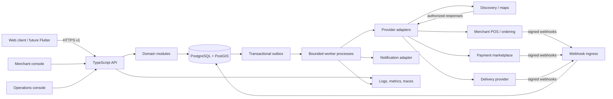

# Project Arrival — Technical Implementation Blueprint

**Status:** Proposed implementation baseline; no production system or provider is selected.
**Research snapshot:** 2026-11-23 (Asia/Calcutta). Revalidate provider terms, prices, features and coverage before contracting or launch.

## Executive decision

Build a TypeScript modular monolith backed by PostgreSQL/PostGIS. Keep the public discovery index separate from operational merchant/catalogue facts, and keep external provider data in license-aware source records. Use a durable database outbox/inbox for external side effects and events. Do not enable an order route until a specific merchant location, recipient market, currency, payment flow and fulfilment route pass capability, contract, legal and operational gates.

No evidence supports a single global, freely reusable restaurant database or universal restaurant POS/order API. Global discovery is a source portfolio and ingestion policy; native orderability is a per-route capability. No candidate integration below is represented as implemented or approved.

## Scope and maturity labels

- **Verified fact:** directly stated in an official source inspected on the snapshot date.
- **Proposed:** Arrival architecture or policy recommendation, not existing behavior.
- **Hypothesis:** testable expectation without adequate evidence yet.
- **Unresolved:** requires contract review, provider confirmation, legal advice or experiment.
- Capability status: planned, prototyped, sandbox-tested, production-verified. Never infer a status from documentation or credentials.

First release sequence: licensed discovery and merchant verification; merchant-authoritative menu/catalogue; one-market, one-merchant ordering pilot; then additional payment and fulfilment routes. Cross-border browsing is allowed. Cross-border ordering is separately gated and must not be implied by a selectable foreign address.

## Domain boundaries

| Module | Owns | Must not own |
|---|---|---|
| Identity & guest access | accounts, sessions, scopes, guest-order access grant hashes | payment credentials |
| Places & discovery | normalized public venue/location projection, source links, merge review, search | authoritative price/menu or order promise |
| Merchant | legal/operating merchant identity, locations, verification, service capabilities | courier events |
| Catalogue | versioned menus, items, modifiers, merchant availability and source | checkout totals |
| Serviceability | address resolution provenance, market gates, provider results/expiry | inferred delivery guarantee |
| Checkout | validation, immutable expiring quote and price arithmetic | charge settlement |
| Orders | accepted purchase snapshot and customer-visible order lifecycle | provider-specific status values |
| Payments | payment attempts, authorization/capture/void/refund and reconciliation | card data |
| Fulfilment | delivery quote/dispatch/tracking state, assignments and milestones | invented location or ETA |
| Provider adapters | auth, API mapping, rate limits, signatures and provider IDs | domain policy decisions |
| Operations & audit | approvals, exceptions, manual action trail, market capability changes | unaudited financial mutations |
| Notifications | consent-aware delivery of approved events | source of transaction truth |

Modules share one database initially but write only owned tables through application interfaces. Cross-module reads are explicit query interfaces; vendor SDK use stays inside adapters. Extract a worker/service only when measured availability, scaling, security or ownership needs warrant it.

## Production topology and flows

### Order orchestration sequence

~~~mermaid
sequenceDiagram
  actor Guest
  participant API
  participant DB as PostgreSQL
  participant Worker
  participant Merchant
  participant Payment
  participant Courier as Fulfilment
  Guest->>API: Request checkout quote
  API->>Merchant: Validate catalogue and availability
  API->>Courier: Quote destination
  API->>DB: Persist quote and expiry
  API-->>Guest: Quote with total and expiry
  Guest->>API: Submit quote with idempotency key
  API->>DB: Create order and outbox atomically
  API-->>Guest: 202 pending and scoped access grant
  Worker->>Payment: Authorize or collect with durable key
  Payment-->>Worker: Provider result or unknown outcome
  Worker->>Merchant: Submit after payment policy gate
  Merchant-->>Worker: Accepted or rejected event
  Worker->>Payment: Capture, void or refund compensation
  Worker->>Courier: Dispatch after configured gates
  Courier-->>DB: Signed lifecycle event through inbox
  DB-->>Guest: Truthful independent timeline
~~~

### Discovery flow

Authorized source query or merchant submission → minimized permitted source fields → source/license policy check → normalization and field provenance → candidate matching → automatic link only when conservative thresholds pass → otherwise review queue → public location projection with timestamps, attribution and discoverable status. A source result may be rendered on demand without copying it into Arrival’s searchable database if terms prohibit retention/indexing.

### Order flow

Destination resolves → market rules and merchant capability evaluated → catalogue version and availability checked → delivery quote obtained if required → server creates short-lived quote with integer minor-unit line/tax/fee totals and provider quote expiry → atomic idempotency claim creates order snapshot and outbox messages → payment authorization/collection follows the selected route → merchant acceptance → capture or void/refund decision → dispatch when merchant and payment gates permit → authenticated events update independent timelines → periodic reconciliation repairs missed events. External actions can succeed while responses are lost; durable commands must be safely retried or queried before another side effect.

## Cross-border transaction model

Represent these independently: merchant legal country, operating location, recipient destination country, payment-provider platform country, connected merchant country, presentment currency, settlement currency, acquiring region, fulfilment service area, tax responsibility and data residency. ISO country/currency codes do not imply permission.

For the initial pilot, require same-country merchant, recipient, platform settlement route and delivery route unless Legal/Compliance and the chosen provider explicitly approve a documented exception. This is a conservative proposed launch policy, not a universal legal rule. Seller-of-record/merchant-of-record classification must be determined by counsel and provider contracts per market. Funds flow, tax, chargeback liability, FX disclosure, KYC/AML, sanctions, consumer cancellation/refund rules, food labeling, privacy transfers and courier insurance are launch gates.

Address resolution is not serviceability. Checkout quote expiry is the earliest of configured maximum age, menu-price validity, market rules and fulfilment quote expiry. Requote if any bound passes. Never route a foreign delivery to current GPS implicitly.

## Reliability and security

Write state transition and outbox row in one DB transaction. Workers use bounded exponential backoff with jitter, documented provider idempotency, inbox uniqueness by provider/account/event identity and an operator queue after exhausted/ambiguous outcomes. Timeout after external write means unknown, not failed. Query or reconcile before repeating. Respect Retry-After; circuit-break on provider-wide failure; do not retry validation/auth errors blindly.

Webhook ingress enforces body-size/time limits, preserves raw bytes for signature verification, validates provider signature/timestamp, binds secrets to provider accounts, rejects stale/replayed events, persists inbox before acknowledgment and processes asynchronously. Retain redacted evidence and provide replay tooling. Provider-specific retry windows and signature semantics belong in adapter runbooks.

Security domains: public read API; authenticated customer; merchant tenant; privileged operator; isolated webhook ingress; provider credential vault; restricted personal-data store. Use explicit authorization in addition to PostgreSQL RLS. Hash high-entropy guest access secrets with a keyed hash; return the raw secret once and never put it in analytics/referrer URLs. Encrypt address/contact fields, tightly scope decryption to fulfilment/support, redact logs and define deletion/financial retention. No raw card data. Audit overrides, refunds, merchant verification and capability changes.

## Technology decisions

- TypeScript: API, domain modules, adapter contracts and web/merchant/operations clients. Strict compiler settings; validate boundary schemas.
- PostgreSQL/PostGIS: transactional data and spatial filtering; GIST geometry indexes, GiST geography for radius queries; test extension/version operations.
- Rust: candidate for isolated ingestion/normalization or high-throughput geo processing only after measured memory, throughput or availability need. No phase-0 runtime.
- C++: algorithm benchmark implementation only where experiments need high-performance comparison or specialized libraries; no parallel business-rule implementation.
- Dart/Flutter: future customer app after mobile-specific evidence; backend contracts remain canonical.
- No new queue/database/search service until workload tests show PostgreSQL plus outbox insufficient. Provider map/places APIs are not a database or bulk-ingestion source.

## Rollout gates

1. Data-source permission and retention matrix signed off before ingestion.
2. Market/provider capability record includes evidence, contract owner, review/expiry date, supported operation, currency and exact area.
3. Adapter contract and failure tests pass; sandbox status remains distinct.
4. Merchant contract, live acceptance, payment fund flow, refunds, delivery path and support rehearsed in a controlled pilot.
5. Security/privacy/legal/consumer disclosure reviews complete; on-call, reconciliation, restore and incident plan exercised.
6. Production enablement is an audited operator action with evidence and rollback/disable path.

See [provider research](research/PROVIDERS.md), [database proposal](database/README.md), [API contract](api/openapi.yaml), [algorithm roadmap](research/ALGORITHMS.md), [security/reliability](SECURITY_RELIABILITY.md) and [backlog](BACKLOG.md).
